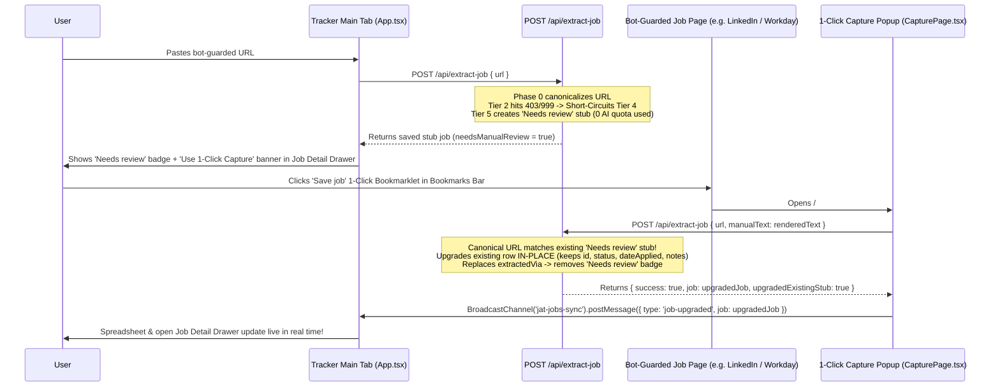
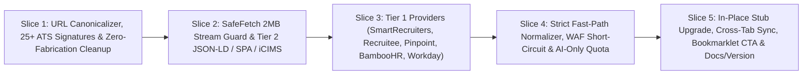

# Solution Architecture: Expanded Multi-Portal Job Link Scanning & Heuristic Engine

**Document Status**: Architecture Blueprint & Implementation Contract (v2.1 — Approved Design Decisions)  
**Author**: Antigravity Solution Architect & Critical Reviewer  
**Target Systems**: `src/lib/atsDetect.ts`, `src/lib/duplicateDetection.ts`, `src/lib/companyName.ts`, `src/lib/salary.ts`, `src/lib/formatHelpers.ts`, `src/lib/captureBookmarklet.ts`, `server/services/parsing/*`, `server/middleware/extractionLimit.ts`, `server/routes/extract.routes.ts`, `src/components/JobDetailModal.tsx`, `src/components/CapturePage.tsx`, `src/components/AtsDiagnosticModal.tsx`  
**Related Specs / Standards**: `PRD.md` (Section 2, 4.1, 4.2, 4.4), `AGENTS.md`, Schema.org `JobPosting`

---

## Executive Summary

The objective of this architectural expansion is to evolve the job ingestion pipeline from a 4-provider system (Greenhouse, Lever, Workable, Ashby + basic Cheerio + Gemini) into an industrial-grade, multi-tier scanning engine supporting:
- **Enterprise ATS Platforms**: Workday, iCIMS, Oracle Cloud HCM, Taleo, SAP SuccessFactors, Darwinbox, ADP Workforce Now, Dayforce, UKG
- **Modern Tech ATS Platforms**: SmartRecruiters, BambooHR, Recruitee, Pinpoint, Rippling, Gem, Dover, Comeet
- **Mid-Market HRIS & Portals**: Breezy HR, Personio, Teamtailor, JazzHR, Jobvite, Paylocity, Paycor, Homerun, Workstream
- **Job Aggregators & Ecosystems**: LinkedIn, Indeed, Glassdoor, Wellfound (AngelList), BuiltIn, YC Work at a Startup, ZipRecruiter

This v2.1 architecture document synthesizes the foundational multi-tier vision with **twelve codebase-grounded architectural refinements, SSRF & Cloudflare Worker resource hardening, cross-module integration contracts, an unsparing skeptic's critique, and seven locked-in architectural decisions (Section 2A)** covering Fast-Path execution, WAF short-circuiting, in-place `Needs review` stub upgrades via the 1-Click Bookmarklet, real-time cross-tab synchronization, and token-aware daily quota accounting.

---

## 1. High-Level Architecture & Pipeline Flow

The ingestion pipeline coordinates five discrete layers with an early exit (**"Strict Fast-Path"**) when high-confidence structured metadata is retrieved—saving 60–80% of LLM latency and token costs—and a **Short-Circuit WAF Bypass** when known anti-bot or login walls block automated cloud IPs.

```
                         Incoming Job URL or Bookmarklet / Paste Payload
                                           │
                                           ▼
                       ┌───────────────────────────────────────┐
                       │   Phase 0: Pre-Flight Canonicalizer   │
                       │   • Unwrap aggregator redirects (URL) │
                       │   • Rewrite LinkedIn/Indeed view URLs │
                       │   • Strip /apply, /application, UTMs  │
                       │   • Preserve ?gh_jid, ?ashby_jid, etc.│
                       │   • SSRF guard via assertPublicUrl()  │
                       └───────────────────┬───────────────────┘
                                           │
                                           ▼
                       ┌───────────────────────────────────────┐
                       │    Phase 1: ATS Signature Detector    │
                       │    (Matches 25+ Board & ATS Patterns) │
                       └───────────────────┬───────────────────┘
                                           │
              ┌────────────────────────────┴───────────────────────────┐
              │ Matched Known ATS API                                  │ Unmatched / Generic / SPA
              ▼                                                        ▼
┌─────────────────────────┐                              ┌─────────────────────────┐
│ Tier 1: ATS Public APIs │                              │ Tier 2: Enhanced Scraper│
│ • Greenhouse, Lever     │                              │ • Stream-bounded (2MB)  │
│ • Workable (.md + v3)   │                              │ • Recursive JSON-LD     │
│ • Ashby Posting API     │                              │ • SPA Hydration State   │
│ • Workday CXS (JSON)    │                              │   (__NEXT_DATA__, etc.) │
│ • SmartRecruiters API   │                              │ • Meta tags & iCIMS DOM │
│ • Recruitee, BambooHR   │                              └────────────┬────────────┘
│ • Pinpoint, Breezy, etc.│                                           │
└────────────┬────────────┘                                           │
             │                                                        │
             │ High-Confidence Structured Data + Clean Summary?       │ High-Confidence JSON-LD / State?
             ├────────────────────────────────────────────────────────┤
             │ YES (Strict Fast-Path Normalizer - 0 AI Quota Charged) │
             ▼                                                        │
┌─────────────────────────┐                                           │
│ Tier 1.5 / 2.5: Direct  │                                           │ NO (Incomplete / Raw Text)
│ Deterministic Normalizer│                                           │
│ + Heuristic Skill/Team  │                                           │
└────────────┬────────────┘                                           ▼
             │                                           ┌─────────────────────────┐
             │                                           │ WAF / Bot Wall Check    │
             │                                           │ • HTTP 401/403/429/999  │
             │                                           │   or login/bot shell?   │
             │                                           └─────┬─────────────┬─────┘
             │                                       NO (Has   │             │ YES (Blocked /
             │                                       content)  │             │ Auth Wall)
             │                                                 ▼             ▼
             │                                    ┌─────────────────┐ ┌─────────────────────────┐
             │                                    │ Tier 3: Gemini  │ │ Tier 4: Gemini 3.8 Flash│
             │                                    │ 3.8 Flash       │ │ URL Context Tool        │
             │                                    │ (Scraped Text)  │ │ (Skipped on WAF/Auth!)  │
             │                                    └────────┬────────┘ └────────────┬────────────┘
             │                                             │                       │ Failed / Blocked?
             │                                             └───────────┬───────────┘
             │                                                         ▼
             │                                           ┌─────────────────────────┐
             │                                           │ Tier 5: Deterministic   │
             │                                           │ URL & Regex Fallback    │
             │                                           │ ("Needs review" stub +  │
             │                                           │  1-Click Capture CTA)   │
             │                                           └────────────┬────────────┘
             │                                                        │
             ▼                                                        ▼
└─────────────────────────────────────────────────────────────────────────┘
                      Standardized ExtractedJobAttributes
      (Zero-Fabrication Contract • Canonical URL Stored • In-Place Stub Upgrade)
```

---

## 2A. Locked-In Architectural Decisions (Design Review Alignment)

During the `/grill-me` design review, the following seven core architectural decisions were finalized and serve as the binding contract for implementation:

### Decision 1: Strict Fast-Path Execution (Tier 1.5 & Tier 2.5)
- **Rule**: Whenever Tier 1 (Public ATS API) or Tier 2 (Schema.org `JobPosting` JSON-LD / SPA Hydration State) yields a valid `company`, `jobTitle`, `location`, and substantive description text (`>= 200` cleaned characters), the pipeline normalizes the record deterministically in `< 5ms` and **skips Tier 3 (Gemini)** completely.
- **Enrichment**: `fastPathNormalizer.ts` deterministically extracts `team` from the title, matches `requiredSkills` against a curated technical/product/domain taxonomy, classifies `seniority` and `department`, strips boilerplate HTML into a 3–4 sentence `summary`, and delegates `companyMetadata` enrichment to `resolveCompanyFacts()` (Wikidata + 12h cache + existing company jobs).

### Decision 2: Immediate WAF / Auth-Wall Short-Circuit
- **Rule**: When a link targets a login-walled or bot-guarded portal (e.g., LinkedIn returning `HTTP 999`, Darwinbox SPA shell, or Cloudflare/Akamai returning `401 / 403 / 429` challenge pages) and Tier 2 fails to read the posting, the pipeline **immediately short-circuits past Tier 4 (`extractWithUrlContext`)** directly to Tier 5 (Deterministic Fallback).
- **Impact**: Eliminates the 20–40 second hang waiting for `url_context` to hit the same login/bot wall, returning a `Needs review` stub snapshot in `< 3 seconds`.

### Decision 3: In-Place Auto-Upgrade of `Needs review` Stub Rows (Preventing Unwanted Duplicates)
- **Problem**: If a user pastes a bot-blocked link (saving an incomplete `Needs review` stub row via Tier 5) and then uses the **1-Click Capture Bookmarklet** (or Paste Text with the URL) on that same job page, strict adherence to PRD Rule 1 (*"Re-ingesting adds a new row"*) would either trigger a false-positive Duplicate Warning modal or create two rows for the same application.
- **Rule (Refined PRD Rule 1 Exception)**:
  - **Completed snapshots remain 100% immutable**: Once a job has been captured with real content (`needsManualReview(existing.extractedVia) === false`), re-ingesting that URL later flags a duplicate and saves a new row if confirmed.
  - **Incomplete `Needs review` stubs upgrade in-place**: When `POST /api/extract-job` runs and produces a **complete** extraction (`needsManualReview(newTierUsed) === false`, e.g., via 1-Click Bookmarklet or Paste Text with URL), and the user already has an existing row with the **exact same canonical URL** (`normalizeJobUrl(existing.url) === normalizeJobUrl(canonicalUrl)`) where `needsManualReview(existing.extractedVia) === true`:
    - The server **updates the existing stub row in-place** (`jobRepository.updateJob`) with the newly extracted `company`, `jobTitle`, `team`, `location`, `salary`, `salaryMin`, `salaryMax`, `industry`, `summary`, `companyMetadata`, `positionMetadata`, and `extractedVia`.
    - All user-owned fields on that existing row (`id`, `status`, `dateApplied`, `dateAdded`, `createdAt`, `notes`, `statusHistory`) are **strictly preserved**.
    - No duplicate warning is triggered, and no second row is created.

### Decision 4: Always-Visible 1-Click Capture Guidance on `Needs review` Jobs
- **Rule**: Whenever a user views a job in `JobDetailModal.tsx` where `needsManualReview(job.extractedVia) === true`, display a prominent, helpful callout banner inside the drawer:
  - Explains that the portal blocked automated reading and shows how to complete the snapshot in one click using the **1-Click Capture Bookmarklet** on the job posting tab (which will automatically upgrade the stub row in-place).
  - Includes an inline **"Set up 1-Click Capture"** button that opens `BookmarkletModal.tsx` directly from the drawer so the user never has to hunt through the Settings gear menu.

### Decision 5: Real-Time Cross-Tab Synchronization via `BroadcastChannel`
- **Rule**: When the `CapturePage.tsx` popup saves a new job or upgrades an existing `Needs review` stub row in-place:
  - It broadcasts a `{ type: 'job-saved' | 'job-upgraded', job: savedJob }` message over `new BroadcastChannel('jat-jobs-sync')` (with a `localStorage` event fallback).
  - `useJobsState.ts` and `App.tsx` listen to this channel and immediately upsert `savedJob` into `jobs` state and update `selectedJob` if the Job Detail drawer is currently open—giving the user an instant, zero-refresh live update in their main tracker tab.

### Decision 6: Always Persist the Canonical / Unwrapped URL in `JobRecord.url`
- **Rule**: Phase 0 canonicalization runs at the start of `POST /api/extract-job` and `POST /api/test-ats-diagnostic`. The unwrapped, canonicalized URL (stripped of `/apply`, `/application`, and tracking noise, or unwrapped from an aggregator redirect) is stored directly in `JobRecord.url`.
- **Impact**: Guarantees that `Open Posting` links, 6-month duplicate detection, and in-place `Needs review` stub upgrades from the 1-Click Bookmarklet all match the clean destination URL.

### Decision 7: AI-Token-Aware Daily Quota Accounting (`EXTRACTION_DAILY_LIMIT`)
- **Rule**: The 30/day user extraction allowance (`takeDailyUsage(scope, 'extraction')`) exists to protect Gemini API quota.
- **Refinement**: Move the `takeDailyUsage(scope, 'extraction')` check/decrement out of the blind pre-request middleware and into the Gemini execution boundary (or only charge when Tier 3 or Tier 4 Gemini inference is invoked).
  - **Strict Fast-Path (Tier 1.5 / 2.5)** and **WAF Short-Circuit (Tier 5)** extractions consume **0 Gemini tokens** and do **not** burn the user's 30/day AI extraction quota.
  - If a user has exhausted their 30/day Gemini quota, Tier 1 + Fast-Path and Tier 2 JSON-LD + Fast-Path links *still work at full accuracy*, and unstructured pages gracefully fall back to the deterministic parser rather than returning a hard HTTP 429 error!

---

## 2B. Solution Architect Technical Refinements & Codebase Alignment

A thorough audit of the repository (`src/lib/`, `server/services/parsing/`, `server/routes/extract.routes.ts`) identified twelve technical refinements required across Node and Cloudflare Workers:

### Refinement 1: Tier 1 Providers Must Use `fetchPublicUrl` (SSRF Hardening)
* **Codebase Finding**: Currently, `scrapeHtmlWithCheerio` in `server/services/parsing/utils/htmlCleaner.ts` uses `fetchPublicUrl()` from `safeFetch.ts`, but the existing Tier 1 providers (`greenhouse.provider.ts`, `lever.provider.ts`, `workable.provider.ts`, `ashby.provider.ts`) call global `fetch()` directly.
* **Contract**: Every network call across **all** Tier 1 providers and Tier 2 iframe/API resolvers MUST route through `fetchPublicUrl()` in `server/services/parsing/utils/safeFetch.ts`.

### Refinement 2: True Streaming Byte-Limit in `safeFetch.ts` for Cloudflare Workers
* **Architectural Critique**: Simply checking `Content-Length` is insufficient because many enterprise career portals (Workday, SuccessFactors, Oracle HCM) use `Transfer-Encoding: chunked` without a `Content-Length` header. Calling `await response.text()` on a 15MB chunked response buffers the entire string into V8 heap memory before any length check can run, risking Worker memory (128MB) or CPU (50ms) limits.
* **Revision**: Implement `readResponseTextUpTo(response: Response, maxBytes = 2 * 1024 * 1024): Promise<string>` inside `safeFetch.ts` using `response.body?.getReader()`. Accumulate byte chunks up to `maxBytes` and call `reader.cancel()` cleanly if exceeded, decoding only the safe prefix with `TextDecoder`. Reduce `MAX_REDIRECTS` in `safeFetch.ts` from `5` to `3` to bound Cloudflare DoH subrequests.

### Refinement 3: Fixing Legacy Benchmark Salary Fabrication in `src/lib/salary.ts`
* **Codebase Finding**: `src/lib/salary.ts` (lines 145–168 and 201–257) still contains `getBenchmarkSalary(company, jobTitle)` which injects hardcoded salaries (`"150k - 170k"` for Transcarent, `"120k - 200k"` for Veeva, `"102k - 152k"` for Ensemble, `"170k - 200k"` for Datavant) whenever `extractSalaryFromTextOrJson` is called with `company` and `jobTitle` hints and no salary is found in the text.
* **Revision**: Remove `getBenchmarkSalary()` invocations from `extractSalaryFromTextOrJson()` so no extraction path can ever leak synthetic salary ranges, strictly enforcing Section 2 of `PRD.md`.

### Refinement 4: Preserving `needsManualReview()` Compatibility (`src/lib/formatHelpers.ts`)
* **Codebase Finding**: In `src/lib/formatHelpers.ts` (line 319), the UI badge is controlled by:
  ```typescript
  export function needsManualReview(extractedVia?: string | null): boolean {
    return !!extractedVia && /deterministic|resilient dom parser/i.test(extractedVia);
  }
  ```
* **Revision**:
  - Fast-Path Tier 1.5/2.5 normalizations that *did* read structured posting data must **not** include the word `"Deterministic"` in `extractedVia` (use `'ATS API (Greenhouse • Fast-Path)'` or `'Schema.org JobPosting (Fast-Path)'`), so they do **not** trigger the amber `Needs review` warning badge.
  - Conversely, Tier 5 fallbacks where the posting body could not be read must continue using `'Deterministic URL Parser (Free Tier Safety)'` or `'Resilient DOM Parser (Free Tier Safety)'` so `needsManualReview()` evaluates to `true` and enables the in-place bookmarklet upgrade flow (Decision 3).

### Refinement 5: Tier 1.5 / 2.5 Fast-Path Quality Bar (`fastPathNormalizer.ts`)
* **Revision**: Enhance the Fast-Path deterministic normalizer (`server/services/parsing/utils/fastPathNormalizer.ts`) with lightweight, zero-latency deterministic enrichment:
  1. **Description HTML-to-Text & Boilerplate Stripping**: Strip HTML tags, decode entities, skip generic opening headers (`"About Us"`, `"Who We Are"`), and extract the first 3–4 substantive sentences describing the role (capped at 450 chars).
  2. **Deterministic Skill & Attribute Extraction**: Run a curated 120-term technical/product/domain skill taxonomy matcher (`extractSkillsDeterministically(text)`), seniority classifier (`Intern | Junior | Mid-level | Senior | Staff | Principal | Lead | Director | VP`), and department classifier (`Product | Engineering | Design | Data & Analytics | Sales | Marketing | Operations`).
  3. **Strict Fast-Path Eligibility Gate**: Only take the Fast-Path if `company` (non-placeholder), `jobTitle` (non-placeholder), and `location` are all resolved, **AND** clean description text is `>= 200` characters.

### Refinement 6: Short-Circuiting Tier 4 (`url_context`) on Hard WAF / Auth Walls
* **Revision**: Between Tier 2/3 and Tier 4, if the URL belongs to a login-walled or bot-protected host (`linkedin.com`, `wellfound.com`, `glassdoor.com`, `darwinbox.com`, or any response returning HTTP `401`, `403`, `429`, `999`, or a Cloudflare Turnstile challenge shell), skip Tier 4 (`url_context`) immediately and record an actionable diagnostic step pointing to the 1-Click Bookmarklet.

### Refinement 7: Synchronizing `normalizeJobUrl`, `atsCompanySlug`, and `NON_COMPANY_TOKENS` Across Modules
* **Revision**:
  - Expand `NON_COMPANY_TOKENS` in `src/lib/companyName.ts` with all new ATS and aggregator names (`pinpoint`, `teamtailor`, `personio`, `rippling`, `dover`, `jazzhr`, `paylocity`, `taleo`, `oracle`, `successfactors`, `linkedin`, `indeed`, `glassdoor`, `wellfound`, `builtin`, `ziprecruiter`) and unify `OG_SITE_NAME_ATS_NOISE` in `htmlCleaner.ts` to import from `companyName.ts`.
  - Expand `atsCompanySlug()` and `normalizeJobUrl()` in `src/lib/duplicateDetection.ts` to recognize all 25+ ATS provider URL patterns and preserve all ATS job ID query parameters (`gh_jid`, `ashby_jid`, `requisitionNo`, `jobId`, `for`, `token`, `jk`, `currentJobId`).

### Refinement 8: Correcting Provider Endpoint Mechanics (Workable `.md` + API v3 & Ashby Posting API)
* **Revision**: Keep Ashby's verified `https://api.ashbyhq.com/posting-api/job-board/{board}?includeCompensation=true` REST endpoint, and enhance `WorkableProvider` to support both `https://apply.workable.com/api/v3/accounts/{board}/jobs/{shortcode}` (JSON) and the fast `.md` endpoint (`/jobs/view/{id}.md` and `/j/{id}.md`).

### Refinement 9: Embedded ATS Resolution Without False Board Guessing
* **Revision**:
  1. Only match `?gh_jid=` unconditionally as embedded Greenhouse; only match generic `?job_id=` as Greenhouse if no other ATS domain signature matched first.
  2. In `scrapeHtmlWithCheerio` (Tier 2), if Tier 1 Greenhouse board-name guessing failed with 404 on a custom domain, inspect the HTML DOM for embedded Greenhouse/Ashby script or iframe URLs (e.g., `boards.greenhouse.io/embed/job_board/js?for={actual_board}` or `boards.greenhouse.io/embed/job_app?for={actual_board}&token={id}`) and extract the exact `board` slug.

### Refinement 10: Handling Multi-Location & Non-Annual Compensation in Schema.org `JobPosting`
* **Revision**: Build a dedicated, unit-tested `schemaOrgNormalizer.ts` that checks `unitText` (`HOUR` -> format as `$75 - $95 / hr` with `salaryMin: null, salaryMax: null`, never multiplying hourly rates by `1,000` into `$75k`), handles array `jobLocation` and `jobLocationType: "TELECOMMUTE"`, and decodes HTML entities safely.

### Refinement 11: LinkedIn Guest Job View & Indeed Canonical Rewriting
* **Revision**:
  - Rewrite LinkedIn URLs containing `currentJobId={id}` (e.g., `/jobs/collections/` or `/jobs/search/`) or `/jobs/view/{slug}-{id}` to `https://www.linkedin.com/jobs/view/{id}`.
  - Rewrite Indeed URLs containing `vjk={id}` or `jk={id}` on `/jobs` to `https://www.indeed.com/viewjob?jk={id}`.

### Refinement 12: Bookmarklet + URL Context Enrichment (`CapturePage.tsx` -> `extract.routes.ts`)
* **Codebase Finding**: When `CapturePage.tsx` calls `POST /api/extract-job` with `{ url: payload.url, manualText: payload.text }`, `JobParsingEngine.extract(targetUrl, manualText)` (in `server/services/parsing/index.ts`, line 48) currently calls `extractWithGemini({ sourceType: 'Manual Text Input', rawContent: manualText })` **without passing `url: targetUrl` or `companyHint`!**
* **Revision**: Pass `url: targetUrl` and `companyHint: cleanCompanyName(targetUrl)` into `extractWithGemini` when `manualText` is provided alongside a `targetUrl` (such as from the 1-Click Bookmarklet!). Additionally, before calling Gemini on bookmarklet text, check if the user has remaining daily Gemini quota; if not, fall back cleanly to `parseManualTextDeterministically(manualText, targetUrl)`.

---

## 3. Skeptic's Critique & Operational Reality Checks

1. **The "WAF Arms Race" (Cloud Datacenter IPs vs. Enterprise Bot Management)**:
   - Platforms like **Workday, LinkedIn, Indeed, Glassdoor, Darwinbox, and Oracle Cloud HCM** use Cloudflare Turnstile, Akamai Bot Manager, or PerimeterX that flag cloud datacenter IPs (Cloudflare Workers, Render, AWS).
   - **Mitigation**: Fail fast via the WAF Short-Circuit (Decision 2), save a clean `Needs review` stub, surface the inline **1-Click Capture Bookmarklet** banner in the Job Detail drawer (Decision 4), and auto-upgrade that stub in-place as soon as the user clicks the bookmarklet on the job tab (Decision 3 + Decision 5).
2. **Maintenance Burden of Unofficial Private APIs**:
   - While Greenhouse, Lever, SmartRecruiters, Recruitee, Pinpoint, and Ashby provide stable public posting endpoints, Workday CXS (`/wday/cxs/...`) is an internal SPA API.
   - **Mitigation**: Every Tier 1 provider is wrapped in a non-fatal `try / catch` inside `JobParsingEngine.extract()`. If Workday CXS returns 403/404 or unexpected JSON, it immediately falls back to Tier 2 (which reads Workday's server-rendered `<script type="application/ld+json">` when available).
3. **Aggregator Brand Contamination**:
   - Scraping an aggregator page often captures `<meta property="og:site_name" content="LinkedIn">` or `"Indeed"`.
   - **Mitigation**: Include all aggregator brands in `NON_COMPANY_TOKENS`, prioritize JSON-LD `hiringOrganization.name` over `og:site_name`, and unwrap external redirect targets in Phase 0.

---

## 4. Detailed Component & Tier Specification

### 4.1 Phase 0 & Phase 1: URL Canonicalization & Signature Engine (`src/lib/atsDetect.ts`)

```typescript
export type AtsProviderType =
  // Existing Tier 1 / Detected
  | 'greenhouse'
  | 'lever'
  | 'workable'
  | 'ashby'
  | 'darwinbox'
  | 'gem'
  // Enterprise ATS
  | 'workday'
  | 'icims'
  | 'oracle'
  | 'taleo'
  | 'successfactors'
  // Modern Tech ATS (Public JSON APIs)
  | 'smartrecruiters'
  | 'bamboohr'
  | 'recruitee'
  | 'pinpoint'
  | 'rippling'
  | 'dover'
  // Mid-Market HRIS & Portals
  | 'breezy'
  | 'personio'
  | 'teamtailor'
  | 'jobvite'
  | 'jazzhr'
  | 'paylocity'
  // Aggregators
  | 'linkedin'
  | 'indeed'
  | 'glassdoor'
  | 'wellfound'
  | 'builtin'
  | 'yc';

export interface AtsDetection {
  type: AtsProviderType | null;
  board?: string;
  jobId?: string;
  canonicalUrl?: string;
  unwrappedFrom?: string;
  datacenter?: string; // e.g., wd1, wd3, wd5, wd12 for Workday
  site?: string;       // e.g., career site slug for Workday / Oracle
  isAggregator?: boolean;
  requiresBrowserAuth?: boolean;
}
```

#### Phase 0 Canonicalization Rules (`canonicalizeJobUrl(rawUrl: string)`):
1. **Aggregator Redirect Unwrapping**:
   - Inspect `url`, `redirect_url`, `dest`, `target`, `u`, `externalUrl` on redirect paths (`linkedin.com/redir/redirect`, `indeed.com/rc/clk`, `glassdoor.com/partner/jobListing.htm`).
   - Decode valid `http(s)://` target URLs, record `unwrappedFrom`, and re-run canonicalization on the destination URL.
2. **Aggregator View-URL Normalization**:
   - **LinkedIn**: Rewrite `currentJobId={id}` or `/jobs/view/{slug}-{id}` to `https://www.linkedin.com/jobs/view/{id}`.
   - **Indeed**: Rewrite `vjk={id}` or `jk={id}` on `/jobs` to `https://www.indeed.com/viewjob?jk={id}`.
3. **Application Sub-Route Trimming**:
   - Strip `/apply`, `/application`, `/apply/start`, `/apply/manual`, `/apply/login`, `/apply/linkedin`, `/c/new`, `.md`.
4. **Query Parameter Whitelisting**:
   - **Strip**: `utm_*`, `ref`, `refId`, `trackingId`, `source`, `src`, `fbclid`, `gclid`, `mc_eid`, `lever-source`, `lever-origin`, `gh_src`, `_ga`, `_gl`, `rx_*`, `ittk`.
   - **Preserve**: `gh_jid`, `ashby_jid`, `job_id`, `jobId`, `id`, `requisitionNo`, `reqId`, `requisitionId`, `postingId`, `for`, `token`, `jk`, `vjk`, `currentJobId`, `locale`, `lang`.
5. **Embedded ATS Resolution**:
   - `?gh_jid={id}` -> `type: 'greenhouse'`, `jobId: id`, `board: searchParams.get('for') || searchParams.get('board') || extractHostSlug(host)`.
   - `?ashby_jid={uuid}` -> `type: 'ashby'`, `jobId: uuid`, `board: extractHostSlug(host)`.

---

### 4.2 Tier 1: Public JSON API Provider Matrix (`server/services/parsing/providers/`)

All Tier 1 providers route through `fetchPublicUrl()` (`safeFetch.ts`) with a 5,000ms–6,000ms timeout and pass their structured output through `tryFastPathNormalize()` before ever considering Gemini Tier 3.

| Provider | URL Signature Pattern | Tier 1 Public Endpoint | Strategy & Fallback Notes |
|---|---|---|---|
| **Greenhouse** | `boards.greenhouse.io/{board}/jobs/{id}`<br>`job-boards.greenhouse.io/{board}/jobs/{id}`<br>`?gh_jid={id}` | `GET https://boards-api.greenhouse.io/v1/boards/{board}/jobs/{id}?questions=false` | Probes `[board, board2, boardcareers, boardjobs, boardinc]`. If 404 on custom domain, Tier 2 extracts embedded `for={board}` from DOM. |
| **Lever** | `jobs.lever.co/{board}/{id}`<br>`jobs.eu.lever.co/{board}/{id}` | `GET https://api.lever.co/v0/postings/{board}/{id}` (or `api.eu.lever.co`) | Returns structured `text`, `categories` (`location`, `department`, `team`, `commitment`, `workplaceType`), `salaryRange`, `descriptionPlain`. |
| **Workable** | `apply.workable.com/{board}/j/{id}`<br>`{board}.workable.com/j/{id}` | 1. `GET https://apply.workable.com/api/v3/accounts/{board}/jobs/{id}`<br>2. `GET https://apply.workable.com/{board}/j/{id}.md` | Tries v3 JSON API + fast server-rendered `.md` endpoint. |
| **Ashby** | `jobs.ashbyhq.com/{board}/{id}`<br>`?ashby_jid={id}` | `GET https://api.ashbyhq.com/posting-api/job-board/{board}?includeCompensation=true` | Filters `jobs[]` by `id`. Includes structured `compensation.summaryComponents` and `workplaceType`. |
| **SmartRecruiters** | `jobs.smartrecruiters.com/{company}/{id}` | `GET https://api.smartrecruiters.com/v1/companies/{company}/postings/{id}` | Official public REST API. Returns `name`, `company.name`, `location` (`city`, `region`, `country`, `remote`), `department.label`, `jobAd.sections`, `compensation`. |
| **Recruitee** | `{company}.recruitee.com/o/{slug}` | `GET https://{company}.recruitee.com/api/offers/{slug}` | Official public JSON endpoint. Returns `{ offer: { title, company_name, location, city, country, remote, hybrid, description, requirements, min_salary, max_salary, currency } }`. |
| **Pinpoint** | `{company}.pinpointhq.com/postings/{uuid}`<br>`{company}.pinpointhq.com/en/postings/{uuid}` | `GET https://{company}.pinpointhq.com/postings/{uuid}.json` | Appending `.json` returns clean structured JSON (`data.title`, `data.description`, `data.location.name`, `data.workplace_type`, `data.compensation_minimum`, `data.compensation_maximum`). |
| **BambooHR** | `{company}.bamboohr.com/careers/{id}`<br>`{company}.bamboohr.com/jobs/view.php?id={id}` | `GET https://{company}.bamboohr.com/careers/{id}/detail` | Returns `{ result: { jobOpening: { jobOpeningName, departmentLabel, location: { city, state }, employmentStatusLabel, description, compensation } } }`. |
| **Workday** | `{tenant}.{wd}.myworkdayjobs.com/{locale?}/{site}/job/{loc?}/{slug}` | `GET https://{tenant}.{wd}.myworkdayjobs.com/wday/cxs/{tenant}/{site}/job/{slug}` | Sends `Accept: application/json`. Extracts `jobPostingInfo` (`title`, `jobDescription`, `location`, `additionalLocations`, `timeType`, `jobReqId`). On 403/404, cascades to Tier 2 SSR JSON-LD. |

---

### 4.3 Tier 2: Enhanced Scraper (`htmlCleaner.ts` & `schemaOrgNormalizer.ts`)

1. **Stream-Bounded HTML Fetch**: Uses `readResponseTextUpTo(response, 2 * 1024 * 1024)` to prevent multi-megabyte DOM payloads from exhausting Cloudflare Worker memory.
2. **Recursive Schema.org `JobPosting` Extractor**: Unpacks top-level objects, arrays, and `@graph` collections, decodes HTML entities, normalizes multi-hub `jobLocation` arrays + `TELECOMMUTE` remote flags, and parses `baseSalary` with `unitText` awareness (`YEAR` vs `HOUR`).
3. **SPA Hydration State Extractor**: Extracts job objects from `<script id="__NEXT_DATA__">` (Rippling, Gem, Wellfound, custom Next.js portals) and `window.__INITIAL_STATE__` / `window.__PRELOADED_STATE__`.
4. **iCIMS Iframe Unwrapper**: Detects `#icims_content_iframe` or iCIMS wrapper pages and performs a guarded `fetchPublicUrl` hop to `?in_iframe=1` to retrieve the inner Schema.org `JobPosting` JSON-LD and DOM.

---

### 4.4 In-Place Stub Upgrade & Cross-Tab Sync Flow (`extract.routes.ts`, `CapturePage.tsx`, `JobDetailModal.tsx`)



---

## 5. Phased Implementation Plan & Slice Breakdown

In accordance with `AGENTS.md`, the implementation is structured into **5 discrete, independently testable slices**:



### Slice 1: URL Canonicalizer, 25+ ATS Signatures, & Zero-Fabrication Cleanup
- **Target Files**: `src/lib/atsDetect.ts`, `src/lib/companyName.ts`, `src/lib/duplicateDetection.ts`, `src/lib/salary.ts`, plus unit tests in `src/lib/__tests__/`.
- **Deliverables**:
  - Implement `canonicalizeJobUrl()` and expand `detectAts()` to 25+ providers.
  - Update `normalizeJobUrl()` and `atsCompanySlug()` in `src/lib/duplicateDetection.ts`.
  - Expand `NON_COMPANY_TOKENS` in `src/lib/companyName.ts`.
  - Remove legacy `getBenchmarkSalary()` fabrication from `extractSalaryFromTextOrJson()` in `src/lib/salary.ts`.
  - Add 40+ unit test cases covering aggregator redirect unwrapping, `/apply` stripping, embedded `?gh_jid` / `?ashby_jid`, LinkedIn `currentJobId` rewriting, and Workday tenant/site/datacenter parsing.

### Slice 2: `safeFetch` Streaming Guard & Tier 2 Scraper Overhaul
- **Target Files**: `server/services/parsing/utils/safeFetch.ts`, `server/services/parsing/utils/schemaOrgNormalizer.ts` (new), `server/services/parsing/utils/htmlCleaner.ts`, `server/services/parsing/providers/{greenhouse,lever,workable,ashby}.provider.ts`, plus unit tests.
- **Deliverables**:
  - Add streaming 2MB byte cap (`readResponseTextUpTo`) and `MAX_REDIRECTS = 3` in `safeFetch.ts`.
  - Build `schemaOrgNormalizer.ts` for recursive `@graph` / array `JobPosting` extraction, HTML-entity decoding, multi-location formatting, and unit-aware (`YEAR` vs `HOUR`) `baseSalary` parsing.
  - Add `extractSpaHydrationData()` (`__NEXT_DATA__`, `window.__INITIAL_STATE__`) and iCIMS `?in_iframe=1` resolution to `htmlCleaner.ts`.
  - Migrate existing Tier 1 providers from raw `fetch()` to `fetchPublicUrl()`.

### Slice 3: New Tier 1 Public API Providers
- **Target Files**: `server/services/parsing/providers/{smartrecruiters,recruitee,pinpoint,bamboohr,workday}.provider.ts`, `server/services/parsing/index.ts`, plus provider unit tests.
- **Deliverables**:
  - Implement and register `SmartRecruitersProvider`, `RecruiteeProvider`, `PinpointProvider`, `BambooHrProvider`, and `WorkdayProvider` (CXS JSON + automatic fallback to Tier 2 SSR JSON-LD on 403/404).

### Slice 4: Strict Fast-Path Normalizer, WAF Short-Circuit, & AI-Token Quota Accounting
- **Target Files**: `server/services/parsing/utils/fastPathNormalizer.ts` (new), `server/services/parsing/index.ts`, `server/middleware/extractionLimit.ts`, plus unit tests.
- **Deliverables**:
  - Implement `tryFastPathNormalize()` (Option A Strict Fast-Path) with deterministic skill taxonomy matching, title/team splitting, seniority/department classification, and executive summary extraction.
  - Implement the WAF / Auth-Wall Short-Circuit in `JobParsingEngine.extract()` so HTTP 401/403/429/999 on bot/login-walled portals skips Tier 4 `url_context`.
  - Update `extractionLimit.ts` / `JobParsingEngine` so `takeDailyUsage(scope, 'extraction')` is only charged when Gemini (Tier 3 or Tier 4) is actually called.

### Slice 5: In-Place Stub Upgrade, Cross-Tab Sync, Bookmarklet Drawer CTA, & Docs/Version Sync
- **Target Files**: `server/routes/extract.routes.ts`, `src/components/CapturePage.tsx`, `src/components/JobDetailModal.tsx`, `src/components/AtsDiagnosticModal.tsx`, `src/hooks/useJobsState.ts`, `src/App.tsx`, `PRD.md`, `package.json`.
- **Deliverables**:
  - Canonicalize incoming URLs in `extract.routes.ts` and store the canonical URL in `JobRecord.url`.
  - Implement in-place upgrade of existing `Needs review` stub rows when a complete extraction (e.g., 1-Click Bookmarklet or Paste Text) arrives for the same canonical URL, preserving user-owned fields (`status`, `dateApplied`, `notes`, `statusHistory`).
  - Add `BroadcastChannel('jat-jobs-sync')` in `CapturePage.tsx` and listener in `useJobsState.ts` / `App.tsx` for instant real-time cross-tab updates.
  - Add the "Use 1-Click Capture to complete this job" banner + inline "Set up 1-Click Capture" modal trigger inside `JobDetailModal.tsx` whenever `needsManualReview(job.extractedVia)` is true.
  - Update `AtsDiagnosticModal.tsx` presets and trace display.
  - Update `PRD.md` (Sections 2, 4.1, 4.2, 4.4) and bump `version` in `package.json` (`0.7.3` -> `0.8.0`).

---

## 6. Verification & Safety Contract

1. **SSRF & Payload Guard**: Every outbound HTTP request across Tier 1 and Tier 2 passes through `fetchPublicUrl()` with DNS IP validation, max 3 redirects, and a 2MB streaming response cap.
2. **Latency & Timeout Bounds**:
   - Tier 1 ATS APIs: 4–6 seconds (`AbortSignal.timeout`).
   - Tier 1.5 / 2.5 Strict Fast-Path: `< 5ms` synchronous normalization (total ingest latency **250–600ms**, **0 Gemini quota charged**).
   - Tier 2 HTML Scraper: 10 seconds.
   - WAF / Auth-Wall Short-Circuit: `< 3 seconds` total fallback time (skips 40s Tier 4 `url_context` wait, **0 Gemini quota charged**).
   - Tier 3 Gemini Structured Extraction: 25 seconds.
   - Tier 4 Gemini URL Context: 40 seconds.
3. **Zero-Fabrication & In-Place Stub Upgrade Invariant**:
   - No benchmark salaries or synthetic company metadata are ever injected.
   - High-confidence Fast-Path reads do *not* trigger `needsManualReview()`; Tier 5 unreadable fallbacks always trigger `needsManualReview()`.
   - Re-capturing a `Needs review` stub via the 1-Click Bookmarklet upgrades the stub in-place without creating a duplicate row; completed snapshots remain immutable.
4. **CI & Governance Compliance (`AGENTS.md`)**:
   - `npm run lint` (`tsc --noEmit`), `npm test` (`vitest run`), and `npm run build` pass with zero errors.
   - `PRD.md` and `package.json` version updated in the implementation PR.
