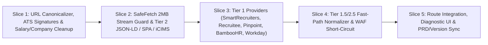

# Solution Architecture: Expanded Multi-Portal Job Link Scanning & Heuristic Engine

**Document Status**: Architecture Blueprint & Implementation Contract (v2.0 — Refined)  
**Author**: Antigravity Solution Architect & Critical Reviewer  
**Target Systems**: `src/lib/atsDetect.ts`, `src/lib/duplicateDetection.ts`, `src/lib/companyName.ts`, `src/lib/salary.ts`, `src/lib/formatHelpers.ts`, `server/services/parsing/*`, `server/routes/extract.routes.ts`, `src/components/AtsDiagnosticModal.tsx`  
**Related Specs / Standards**: `PRD.md` (Section 2, 4.2, 4.4), `AGENTS.md`, Schema.org `JobPosting`

---

## Executive Summary

The objective of this architectural expansion is to evolve the job ingestion pipeline from a 4-provider system (Greenhouse, Lever, Workable, Ashby + basic Cheerio + Gemini) into an industrial-grade, multi-tier scanning engine supporting:
- **Enterprise ATS Platforms**: Workday, iCIMS, Oracle Cloud HCM, Taleo, SAP SuccessFactors, Darwinbox, ADP Workforce Now, Dayforce, UKG
- **Modern Tech ATS Platforms**: SmartRecruiters, BambooHR, Recruitee, Pinpoint, Rippling, Gem, Dover, Comeet
- **Mid-Market HRIS & Portals**: Breezy HR, Personio, Teamtailor, JazzHR, Jobvite, Paylocity, Paycor, Homerun, Workstream
- **Job Aggregators & Ecosystems**: LinkedIn, Indeed, Glassdoor, Wellfound (AngelList), BuiltIn, YC Work at a Startup, ZipRecruiter

This v2.0 architecture document synthesizes the foundational multi-tier vision with **twelve deep codebase-grounded architectural refinements, SSRF & Cloudflare Worker resource hardening, cross-module integration contracts, and an unsparing skeptic's critique** of real-world web scraping failure modes, WAF/bot mitigation barriers, and AI token economics.

---

## 1. High-Level Architecture & Pipeline Flow

The ingestion pipeline coordinates five discrete layers with an early exit (**"Fast-Path"**) when high-confidence structured metadata is retrieved—saving 60–80% of LLM latency and token costs—and a **Short-Circuit WAF Bypass** when known anti-bot walls block automated cloud IPs.

```
                         Incoming Job URL or Bookmarklet / Paste Payload
                                           │
                                           ▼
                       ┌───────────────────────────────────────┐
                       │   Phase 0: Pre-Flight Canonicalizer   │
                       │   • Unwrap aggregator redirects (URL) │
                       │   • Strip /apply, /application, UTMs  │
                       │   • Preserve ?gh_jid, ?ashby_jid, etc.│
                       │   • SSRF guard via assertPublicUrl()  │
                       └───────────────────┬───────────────────┘
                                           │
                                           ▼
                       ┌───────────────────────────────────────┐
                       │    Phase 1: ATS Signature Detector    │
                       │    (Matches 25+ Board & ATS Patterns) │
                       └───────────────────┬───────────────────┘
                                           │
              ┌────────────────────────────┴───────────────────────────┐
              │ Matched Known ATS API                                  │ Unmatched / Generic / SPA
              ▼                                                        ▼
┌─────────────────────────┐                              ┌─────────────────────────┐
│ Tier 1: ATS Public APIs │                              │ Tier 2: Enhanced Scraper│
│ • Greenhouse, Lever     │                              │ • Stream-bounded (2MB)  │
│ • Workable (.md + v3)   │                              │ • Recursive JSON-LD     │
│ • Ashby Posting API     │                              │ • SPA Hydration State   │
│ • Workday CXS (JSON)    │                              │   (__NEXT_DATA__, etc.) │
│ • SmartRecruiters API   │                              │ • Meta tags & iCIMS DOM │
│ • Recruitee, BambooHR   │                              └────────────┬────────────┘
│ • Pinpoint, Breezy, etc.│                                           │
└────────────┬────────────┘                                           │
             │                                                        │
             │ High-Confidence Structured Data + Clean Summary?       │ High-Confidence JSON-LD / State?
             ├────────────────────────────────────────────────────────┤
             │ YES (Fast-Path Normalizer - Zero AI Tokens)            │
             ▼                                                        │
┌─────────────────────────┐                                           │
│ Tier 1.5 / 2.5: Direct  │                                           │ NO (Incomplete / Raw Text)
│ Deterministic Normalizer│                                           │
│ + Heuristic Skill/Team  │                                           │
└────────────┬────────────┘                                           ▼
             │                                           ┌─────────────────────────┐
             │                                           │ WAF / Bot Wall Check    │
             │                                           │ • HTTP 401/403/429 or   │
             │                                           │   empty SPA shell?      │
             │                                           └─────┬─────────────┬─────┘
             │                                       NO (Has   │             │ YES (Blocked /
             │                                       content)  │             │ Auth Wall)
             │                                                 ▼             ▼
             │                                    ┌─────────────────┐ ┌─────────────────────────┐
             │                                    │ Tier 3: Gemini  │ │ Tier 4: Gemini 3.8 Flash│
             │                                    │ 3.8 Flash       │ │ URL Context Tool        │
             │                                    │ (Scraped Text)  │ │ (Skipped on 403 Auth)   │
             │                                    └────────┬────────┘ └────────────┬────────────┘
             │                                             │                       │ Failed / Blocked?
             │                                             └───────────┬───────────┘
             │                                                         ▼
             │                                           ┌─────────────────────────┐
             │                                           │ Tier 5: Deterministic   │
             │                                           │ URL & Regex Fallback    │
             │                                           │ ("Needs review" badge)  │
             │                                           └────────────┬────────────┘
             │                                                        │
             ▼                                                        ▼
└─────────────────────────────────────────────────────────────────────────┘
                      Standardized ExtractedJobAttributes
            (Zero-Fabrication Contract Enforced • Stored Canonical URL)
```

---

## 2. Solution Architect Refinements & Codebase Alignment (v2.0)

A thorough audit of the repository (`src/lib/`, `server/services/parsing/`, `server/routes/extract.routes.ts`) revealed twelve critical refinements required to make this architecture production-ready across both Node and Cloudflare Workers:

### Refinement 1: Tier 1 Providers Must Use `fetchPublicUrl` (SSRF Hardening)
* **Codebase Finding**: Currently, `scrapeHtmlWithCheerio` in `server/services/parsing/utils/htmlCleaner.ts` uses `fetchPublicUrl()` from `safeFetch.ts`, but the existing Tier 1 providers (`greenhouse.provider.ts`, `lever.provider.ts`, `workable.provider.ts`, `ashby.provider.ts`) call global `fetch()` directly.
* **Architectural Risk**: While Greenhouse, Lever, and Ashby use hardcoded API hosts (`boards-api.greenhouse.io`), new multi-tenant subdomain providers (`{company}.recruitee.com`, `{company}.bamboohr.com`, `{tenant}.{wd}.myworkdayjobs.com`, or iCIMS iframe `src` attributes) construct target URLs from user input or untrusted DOM attributes. Calling raw `fetch()` bypasses DNS-over-HTTPS / system DNS IP validation and manual redirect inspection.
* **Contract**: Every network call across **all** Tier 1 providers and Tier 2 iframe/API resolvers MUST route through `fetchPublicUrl()` in `server/services/parsing/utils/safeFetch.ts`.

### Refinement 2: True Streaming Byte-Limit in `safeFetch.ts` for Cloudflare Workers
* **Original Proposal**: Enforce a 2MB maximum payload limit in `fetchPublicUrl` before calling `response.text()`.
* **Architectural Critique**: Simply checking `Content-Length` is insufficient because many enterprise career portals (Workday, SuccessFactors, Oracle HCM) use `Transfer-Encoding: chunked` without a `Content-Length` header. Calling `await response.text()` on a 15MB chunked response buffers the entire string into V8 heap memory before any length check can run, triggering Cloudflare Worker memory limit (128MB) or CPU time (50ms) crashes once Cheerio attempts to parse it.
* **Revision**: Implement `readResponseTextUpTo(response: Response, maxBytes = 2 * 1024 * 1024): Promise<string>` inside `safeFetch.ts` using `response.body?.getReader()`. Accumulate byte chunks up to `maxBytes` and call `reader.cancel()` cleanly if exceeded, decoding only the safe prefix with `TextDecoder`. Reduce `MAX_REDIRECTS` in `safeFetch.ts` from `5` to `3` to bound Cloudflare DoH subrequests (each redirect hop costs up to 2 DNS-over-HTTPS subrequests for `A` and `AAAA` records plus 1 HTTP subrequest).

### Refinement 3: Fixing Legacy Benchmark Salary Fabrication in `src/lib/salary.ts`
* **Codebase Finding**: `src/lib/salary.ts` (lines 145–168 and 201–257) still contains `getBenchmarkSalary(company, jobTitle)` which injects hardcoded salaries (`"150k - 170k"` for Transcarent, `"120k - 200k"` for Veeva, `"102k - 152k"` for Ensemble, `"170k - 200k"` for Datavant) whenever `extractSalaryFromTextOrJson` is called with `company` and `jobTitle` hints and no salary is found in the text!
* **Architectural Critique**: This directly violates Section 2 of `PRD.md` (*"Never invent posting details. When no model actually read the posting, fields that could not be read are stored as Unknown / Not listed, not as plausible defaults or benchmark salaries."*).
* **Revision**: Deprecate and remove `getBenchmarkSalary()` invocations from `extractSalaryFromTextOrJson()` as part of this pipeline overhaul so no Tier 1, Tier 1.5, Tier 2.5, or Tier 5 path can ever leak synthetic salary ranges.

### Refinement 4: Preserving `needsManualReview()` Compatibility (`src/lib/formatHelpers.ts`)
* **Original Proposal**: Set `extractedVia: "Needs review"` on fallback jobs.
* **Codebase Finding**: In `src/lib/formatHelpers.ts` (line 319), the UI badge is controlled by:
  ```typescript
  export function needsManualReview(extractedVia?: string | null): boolean {
    return !!extractedVia && /deterministic|resilient dom parser/i.test(extractedVia);
  }
  ```
* **Revision**: Keep `tierUsed` / `extractedVia` strings semantically descriptive of the tier while matching the contract in `needsManualReview()`. Specifically:
  - Fast-Path Tier 1.5/2.5 normalizations that *did* read structured posting data must **not** include the word `"Deterministic"` in `extractedVia` (use `'ATS API (Greenhouse • Fast-Path)'` or `'Schema.org JobPosting (Fast-Path)'`), because they are high-confidence reads and should **not** trigger the amber `Needs review` warning badge!
  - Conversely, Tier 5 fallbacks where the posting body could not be read must continue using `'Deterministic URL Parser (Free Tier Safety)'` or `'Resilient DOM Parser (Free Tier Safety)'` so `needsManualReview()` evaluates to `true`.

### Refinement 5: Tier 1.5 / 2.5 Fast-Path Quality Bar (Preventing Degraded Summaries & Missing Skills)
* **Original Proposal**: Skip Gemini Tier 3 whenever `title`, `company`, and `location` are present in Tier 1 API or Tier 2 JSON-LD.
* **Architectural Critique**: Currently, when Greenhouse or Ashby calls Gemini Tier 3, Gemini synthesizes a concise 3–5 sentence executive summary, separates `team` from `jobTitle`, infers `industry` and `seniority`, and extracts 4–8 `requiredSkills`. If the Fast-Path normalizer naively slices the first 450 characters of `description` and sets `requiredSkills: []`, `industry: 'Unknown'`, and `seniority: 'Unknown'`, every Fast-Path job in the user's tracker will have degraded metadata (boiler-plate company intro as summary, zero skills tags, unknown seniority).
* **Revision**: Enhance the Fast-Path deterministic normalizer (`server/services/parsing/utils/fastPathNormalizer.ts`) with lightweight, zero-latency deterministic enrichment:
  1. **Description HTML-to-Text & Boilerplate Stripping**: Strip HTML tags, decode entities, skip generic opening headers (`"About Us"`, `"Who We Are"`), and extract the first 3–4 substantive sentences describing the role (capped at 450 chars).
  2. **Deterministic Skill & Attribute Extraction**: Run a curated 120-term technical/product/domain skill taxonomy matcher (`extractSkillsDeterministically(text)`), seniority classifier (`Intern | Junior | Mid-level | Senior | Staff | Principal | Lead | Director | VP`), and department classifier (`Product | Engineering | Design | Data & Analytics | Sales | Marketing | Operations`).
  3. **Strict Fast-Path Eligibility Gate**: Only take the Fast-Path if:
     - `company` (non-placeholder), `jobTitle` (non-placeholder), and `location` are all resolved, **AND**
     - Clean description text is `>= 200` characters (so we have real posting content, not a stub).
     - Otherwise, pass the structured payload to Tier 3 (Gemini 3.8 Flash) for full semantic synthesis.

### Refinement 6: Short-Circuiting Tier 4 (`url_context`) on Hard WAF / Auth Walls (Cutting Failure Latency from 55s to <6s)
* **Codebase Reality**: When a user pastes a LinkedIn, Wellfound, or Cloudflare-protected Darwinbox/Workday URL that returns HTTP `403 Forbidden`, `401 Unauthorized`, or `999` (LinkedIn's custom bot status code), Tier 2 fails after ~2s, and the pipeline currently invokes Tier 4 (`extractWithUrlContext` with a 40-second timeout). Google's `url_context` fetcher is also blocked by LinkedIn (`999`), Cloudflare Turnstile, and login walls—so the user waits 15–40 seconds only for Tier 4 to throw `URL_RETRIEVAL_STATUS_ERROR` and fall back to Tier 5.
* **Revision**: Add a **WAF / Auth-Wall Short-Circuit** between Tier 2/3 and Tier 4:
  - If the URL belongs to a known login-walled aggregator (`linkedin.com`, `wellfound.com`, `glassdoor.com`) AND Tier 2 received HTTP `401`, `403`, `429`, or `999` (or an empty Challenge shell like `cf-mitigated` / `<title>Just a moment...</title>`), skip Tier 4 (`url_context`) immediately.
  - Record a clear diagnostic step explaining that the host requires browser authentication/cookies and recommend the **One-Click Capture Bookmarklet**.
  - Total fallback latency drops from **20–50 seconds** to **< 3 seconds**.

### Refinement 7: Synchronizing `normalizeJobUrl`, `atsCompanySlug`, and `NON_COMPANY_TOKENS` Across Modules
* **Codebase Finding**: URL and company normalization logic is currently split across three files:
  1. `src/lib/atsDetect.ts` (`detectAts`)
  2. `src/lib/duplicateDetection.ts` (`normalizeJobUrl` at line 307, `atsCompanySlug` at line 137)
  3. `src/lib/companyName.ts` (`NON_COMPANY_TOKENS` at line 7) and `server/services/parsing/utils/htmlCleaner.ts` (`OG_SITE_NAME_ATS_NOISE` at line 10)
* **Architectural Risk**:
  - If `src/lib/atsDetect.ts` unwraps an Indeed redirect or strips `/apply` during extraction, `extract.routes.ts` (line 93 & 109) must store and check the **canonical URL** so `findPastSixMonthsDuplicates()` matches existing applications.
  - If `NON_COMPANY_TOKENS` and `OG_SITE_NAME_ATS_NOISE` do not include new ATS and aggregator names (`pinpoint`, `teamtailor`, `personio`, `rippling`, `jazzhr`, `paylocity`, `taleo`, `oracle`, `successfactors`, `linkedin`, `indeed`, `glassdoor`, `wellfound`, `builtin`), the scraper will mistake `<meta property="og:site_name" content="Pinpoint">` or `"LinkedIn"` for the hiring company's name!
* **Revision**:
  - Expand `NON_COMPANY_TOKENS` in `src/lib/companyName.ts` and unify `OG_SITE_NAME_ATS_NOISE` in `htmlCleaner.ts` to import from `companyName.ts`.
  - Expand `atsCompanySlug()` and `normalizeJobUrl()` in `src/lib/duplicateDetection.ts` to recognize all 25+ ATS provider URL patterns and preserve all ATS job ID query parameters (`gh_jid`, `ashby_jid`, `requisitionNo`, `jobId`, `for`, `token`, `jk`, `currentJobId`).
  - In `server/routes/extract.routes.ts`, canonicalize `url` at the top of `POST /api/extract-job` and `POST /api/test-ats-diagnostic` so duplicate detection, company-facts lookup, and the saved `JobRecord.url` all use the clean canonical URL.

### Refinement 8: Correcting Provider Endpoint Mechanics (Workable `.md` + API v3 & Ashby Posting API)
* **Codebase Finding**:
  - `AshbyProvider` in `server/services/parsing/providers/ashby.provider.ts` uses `https://api.ashbyhq.com/posting-api/job-board/{board}?includeCompensation=true` (REST JSON), whereas the v1.0 architecture doc table listed `jobs.ashbyhq.com/api/non-user-graphql`.
  - `WorkableProvider` in `server/services/parsing/providers/workable.provider.ts` fetches Workable's fast server-rendered `.md` endpoint (`/jobs/view/{id}.md` and `/j/{id}.md`). However, `src/lib/atsDetect.ts` must **not** strip `.md` before `WorkableProvider` runs without preserving `jobId`, and `WorkableProvider` can be enhanced to try `https://apply.workable.com/api/v3/accounts/{board}/jobs/{shortcode}` (JSON) alongside `.md` fallback.
* **Revision**: Align Section 4.2's Provider Matrix with the actual verified endpoints in the codebase and add fallback chains within each provider.

### Refinement 9: Embedded ATS Resolution Without False Board Guessing
* **Original Proposal**: Custom domains with `?gh_jid=123` resolve to `type: 'greenhouse'`, `board: <extracted-from-host>`.
* **Architectural Critique**: Look at `src/lib/atsDetect.ts` (lines 130–138): when a company uses a custom domain like `careers.affirm.com/jobs?gh_jid=12345` or `www.datavant.com/open-roles?gh_jid=53013`, guessing `board` from the hostname (`affirm` or `datavant`) works ~60% of the time via `GreenhouseProvider`'s candidate board probing (`[board, board2, boardcareers, boardjobs, boardinc]`), **but** fails when the company's Greenhouse board token differs from their domain (e.g., `block.xyz` using board `squareup`, or `alphabet.com` using `google`). Furthermore, if a URL on `myworkdayjobs.com` or `icims.com` has `?job_id=123`, checking `?job_id` before checking the host would falsely classify it as Greenhouse!
* **Revision**:
  1. Only match `?gh_jid=` unconditionally as embedded Greenhouse; only match generic `?job_id=` as Greenhouse if no other ATS domain signature matched first.
  2. In `scrapeHtmlWithCheerio` (Tier 2), if Tier 1 Greenhouse board-name guessing failed with 404, inspect the HTML DOM for embedded Greenhouse/Ashby script or iframe URLs (e.g., `boards.greenhouse.io/embed/job_board/js?for={actual_board}` or `boards.greenhouse.io/embed/job_app?for={actual_board}&token={id}`) and extract the exact `board` slug!

### Refinement 10: Handling Multi-Location & Non-Annual Compensation in Schema.org `JobPosting`
* **Original Proposal**: Parse `baseSalary.value.minValue` and `jobLocation.address`.
* **Architectural Critique**: Schema.org `JobPosting` payloads in the wild have three common traps that break naive parsers:
  1. **Hourly / Monthly Rates**: `baseSalary.value.unitText` can be `"HOUR"`, `"MONTH"`, `"WEEK"`, or `"YEAR"`. If a contract role specifies `minValue: 75, maxValue: 95, unitText: "HOUR"`, passing `75` and `95` into `salaryMin`/`salaryMax` or `tokenToNumber()` (which multiplies numbers `20 < n < 1000` by `1000` in `src/lib/salary.ts` line 103!) will corrupt `$75/hr` into `$75,000/yr`!
  2. **`jobLocation` Arrays & `applicantLocationRequirements`**: Multi-hub postings provide `jobLocation` as an Array of `Place` objects, or omit `jobLocation` entirely when `jobLocationType: "TELECOMMUTE"` and put the country in `applicantLocationRequirements.name`.
  3. **HTML-Encoded JSON-LD & Double-Escaped Descriptions**: Many CMS/ATS platforms (iCIMS, Jobvite, Workday) HTML-encode the contents of `<script type="application/ld+json">` or double-escape HTML inside `jobPosting.description`.
* **Revision**: Build a dedicated, unit-tested `schemaOrgNormalizer.ts` that checks `unitText` (`HOUR` -> format as `$75 - $95 / hr` with `salaryMin: null, salaryMax: null` or annualized only if explicitly configured, never multiplying `$75/hr` into `75k`), handles array `jobLocation`, and decodes HTML entities safely.

### Refinement 11: LinkedIn Guest Job View & Aggregator Canonical Unwrapping
* **Architectural Enhancement**: When users copy a LinkedIn job link from search results, it often looks like:
  - `https://www.linkedin.com/jobs/collections/recommended/?currentJobId=3912345678`
  - `https://www.linkedin.com/jobs/search/?currentJobId=3912345678&keywords=product`
  Scraping `/jobs/collections/` or `/jobs/search/` always hits LinkedIn's auth wall. However, rewriting any LinkedIn URL containing `currentJobId={id}` or `/jobs/view/{slug}-{id}` to the canonical `https://www.linkedin.com/jobs/view/{id}` gives Tier 2 a much higher chance of hitting LinkedIn's public guest job posting page (which includes Schema.org `JobPosting` JSON-LD when not rate-limited).
* Similarly, Indeed URLs like `https://www.indeed.com/jobs?q=engineer&vjk=abc12345` should canonicalize to `https://www.indeed.com/viewjob?jk=abc12345`.

### Refinement 12: Daily Usage Quota Fairness (`server/middleware/extractionLimit.ts`)
* **Architectural Observation**: Currently, `POST /api/extract-job` and `POST /api/test-ats-diagnostic` both consume 1 unit of the user's `EXTRACTION_DAILY_LIMIT` (30/day) via `extractionLimit` middleware before the pipeline runs—even when Tier 1 + Fast-Path Normalizer resolves the job deterministically with **zero Gemini API calls**.
* **Future-Proof Enhancement**: While keeping `extractionLimit` as an outer abuse guard, Fast-Path extractions that consume zero Gemini tokens protect the server's `GEMINI_API_KEY` quota, allowing the platform to comfortably scale user ingestion volume without increasing AI spend.

---

## 3. Skeptic's Critique & Operational Reality Checks

As the solution architect, here are the real-world obstacles and maintenance realities that must be designed around:

### Critique 1: The "WAF Arms Race" (Cloud Datacenter IPs vs. Enterprise Bot Management)
* **The Reality**: Platforms like **Workday, LinkedIn, Indeed, Glassdoor, Darwinbox, and Oracle Cloud HCM** use Cloudflare Turnstile, Akamai Bot Manager, or PerimeterX. Requests originating from cloud datacenter ASNs (Cloudflare Workers outbound IPs, Render, AWS) carry low IP reputation scores compared to residential browser IPs.
* **The Risk**: Server-side requests to LinkedIn, Indeed, Glassdoor, or strict Workday tenants will frequently receive HTTP `403`, `429`, or `999`.
* **Architectural Mitigation**:
  1. Never pretend server-side scraping can defeat residential IP checks or login walls.
  2. Fail fast (Refinement 6) when a WAF/Auth wall is detected so the user never waits 40 seconds for a doomed retry.
  3. Surface the **One-Click Capture Bookmarklet** (which runs inside the user's authenticated browser tab and sends the already-rendered DOM text to the tracker) directly in the error/review UI and ATS Diagnostic Modal whenever a bot wall is encountered.

### Critique 2: Maintenance Burden of Unofficial Private APIs
* **The Reality**: While Greenhouse, Lever, SmartRecruiters, Recruitee, and Ashby provide documented public posting APIs, endpoints like Workday CXS (`/wday/cxs/...`) and Oracle HCM REST (`hcmRestApi/resources/latest/recruitingCEJobRequisitions`) are internal APIs powering their frontend SPAs.
* **The Risk**: A tenant configuration difference or minor version update can alter JSON structure or return 404/403.
* **Architectural Mitigation**: Every Tier 1 provider is wrapped in a non-fatal `try / catch` inside `JobParsingEngine.extract()`. If a Tier 1 API returns non-200 or unexpected JSON, the engine logs the failure in `diagnosticSteps` and immediately cascades to Tier 2 (HTML + JSON-LD + SPA state) without crashing.

### Critique 3: Aggregator Brand Contamination
* **The Reality**: Scraping an aggregator page (Indeed, LinkedIn, Glassdoor, BuiltIn, Wellfound) often captures `<meta property="og:site_name" content="LinkedIn">` or `<title>... | Indeed.com</title>`, causing naive parsers to record the employer as `"LinkedIn"` or `"Indeed"`.
* **Architectural Mitigation**: Add all aggregator brand names to `NON_COMPANY_TOKENS` in `src/lib/companyName.ts`, prioritize JSON-LD `hiringOrganization.name` over `og:site_name`, and unwrap external redirect targets in Phase 0 whenever present.

---

## 4. Detailed Component & Tier Specification

### 4.1 Phase 0 & Phase 1: URL Canonicalization & Signature Engine (`src/lib/atsDetect.ts`)

Expand `AtsProviderType` and `AtsDetection` to support 25+ ATS and aggregator platforms:

```typescript
export type AtsProviderType =
  // Existing Tier 1 / Detected
  | 'greenhouse'
  | 'lever'
  | 'workable'
  | 'ashby'
  | 'darwinbox'
  | 'gem'
  // Enterprise ATS
  | 'workday'
  | 'icims'
  | 'oracle'
  | 'taleo'
  | 'successfactors'
  // Modern Tech ATS (Public JSON APIs)
  | 'smartrecruiters'
  | 'bamboohr'
  | 'recruitee'
  | 'pinpoint'
  | 'rippling'
  | 'dover'
  // Mid-Market HRIS & Portals
  | 'breezy'
  | 'personio'
  | 'teamtailor'
  | 'jobvite'
  | 'jazzhr'
  | 'paylocity'
  // Aggregators
  | 'linkedin'
  | 'indeed'
  | 'glassdoor'
  | 'wellfound'
  | 'builtin'
  | 'yc';

export interface AtsDetection {
  type: AtsProviderType | null;
  board?: string;
  jobId?: string;
  canonicalUrl?: string;
  unwrappedFrom?: string;
  datacenter?: string; // e.g., wd1, wd3, wd5, wd12 for Workday
  site?: string;       // e.g., career site slug for Workday / Oracle
  isAggregator?: boolean;
  requiresBrowserAuth?: boolean;
}
```

#### Phase 0 Canonicalization Pipeline (`canonicalizeJobUrl(rawUrl: string)`):
1. **Aggregator Redirect Unwrapping**:
   - Inspect query parameters (`url`, `redirect_url`, `dest`, `target`, `u`, `externalUrl`) on known redirect paths (`linkedin.com/redir/redirect`, `indeed.com/rc/clk`, `glassdoor.com/partner/jobListing.htm`).
   - If a valid `http://` or `https://` URL is encoded in the parameter, decode it, record `unwrappedFrom: host`, and restart canonicalization on the destination URL.
   - *Security Invariant*: Any unwrapped URL is still validated by `assertPublicUrl()` inside `fetchPublicUrl()` before any network request is made.
2. **Aggregator View-URL Normalization**:
   - **LinkedIn**: If host is `linkedin.com` and `currentJobId={id}` is present in query params (e.g., from `/jobs/collections/` or `/jobs/search/`), rewrite to `https://www.linkedin.com/jobs/view/{id}`.
   - **Indeed**: If host is `indeed.com` and `vjk={id}` or `jk={id}` is present on `/jobs`, rewrite to `https://www.indeed.com/viewjob?jk={id}`.
3. **Application Sub-Route Trimming**:
   - Strip trailing action sub-routes that point to login/form screens rather than the job description:
     - `/apply`, `/application`, `/apply/start`, `/apply/manual`, `/apply/login`, `/apply/linkedin`, `/c/new` (Breezy apply form).
   - For Workable `.md` URLs (`apply.workable.com/{board}/j/{id}.md`), strip `.md` for the canonical browser URL while preserving `jobId` for `WorkableProvider`.
4. **Query Parameter Whitelisting**:
   - **Strip**: `utm_*`, `ref`, `refId`, `trackingId`, `source`, `src`, `fbclid`, `gclid`, `mc_eid`, `lever-source`, `lever-origin`, `gh_src`, `_ga`, `_gl`, `rx_*`, `ittk`.
   - **Preserve**: `gh_jid`, `ashby_jid`, `job_id`, `jobId`, `id`, `requisitionNo`, `reqId`, `requisitionId`, `postingId`, `for`, `token`, `jk`, `vjk`, `currentJobId`, `locale`, `lang`.
5. **Embedded ATS Resolution**:
   - `?gh_jid={id}` on any domain -> `type: 'greenhouse'`, `jobId: id`, `board: searchParams.get('for') || searchParams.get('board') || extractHostSlug(host)`.
   - `?ashby_jid={uuid}` on any domain -> `type: 'ashby'`, `jobId: uuid`, `board: extractHostSlug(host)`.

---

### 4.2 Tier 1: Public JSON API Provider Matrix (`server/services/parsing/providers/`)

All Tier 1 providers must use `fetchPublicUrl()` from `safeFetch.ts` with a 5,000ms–6,000ms timeout (`AbortSignal.timeout`).

| Provider | URL Signature Pattern | Tier 1 Public Endpoint | Strategy & Fallback Notes |
|---|---|---|---|
| **Greenhouse** | `boards.greenhouse.io/{board}/jobs/{id}`<br>`job-boards.greenhouse.io/{board}/jobs/{id}`<br>`?gh_jid={id}` | `GET https://boards-api.greenhouse.io/v1/boards/{board}/jobs/{id}?questions=false` | Probes `[board, board2, boardcareers, boardjobs, boardinc]`. If 404 on custom domain, Tier 2 extracts embedded `for={board}` from DOM. |
| **Lever** | `jobs.lever.co/{board}/{id}`<br>`jobs.eu.lever.co/{board}/{id}` | `GET https://api.lever.co/v0/postings/{board}/{id}` (or `api.eu.lever.co`) | Returns structured `text`, `categories` (`location`, `department`, `team`, `commitment`, `workplaceType`), `salaryRange`, `descriptionPlain`. |
| **Workable** | `apply.workable.com/{board}/j/{id}`<br>`{board}.workable.com/j/{id}` | 1. `GET https://apply.workable.com/api/v3/accounts/{board}/jobs/{id}`<br>2. `GET https://apply.workable.com/{board}/j/{id}.md` | Tries v3 JSON API + fast server-rendered `.md` endpoint. |
| **Ashby** | `jobs.ashbyhq.com/{board}/{id}`<br>`?ashby_jid={id}` | `GET https://api.ashbyhq.com/posting-api/job-board/{board}?includeCompensation=true` | Filters `jobs[]` by `id`. Includes structured `compensation.summaryComponents` and `workplaceType`. |
| **SmartRecruiters** | `jobs.smartrecruiters.com/{company}/{id}` | `GET https://api.smartrecruiters.com/v1/companies/{company}/postings/{id}` | Official public REST API. Returns `name`, `company.name`, `location` (`city`, `region`, `country`, `remote`), `department.label`, `jobAd.sections`, `compensation`. |
| **Recruitee** | `{company}.recruitee.com/o/{slug}` | `GET https://{company}.recruitee.com/api/offers/{slug}` | Official public JSON endpoint. Returns `{ offer: { title, company_name, location, city, country, remote, hybrid, description, requirements, min_salary, max_salary, currency } }`. |
| **Pinpoint** | `{company}.pinpointhq.com/postings/{uuid}`<br>`{company}.pinpointhq.com/en/postings/{uuid}` | `GET https://{company}.pinpointhq.com/postings/{uuid}.json` | Appending `.json` returns clean structured JSON (`data.title`, `data.description`, `data.location.name`, `data.workplace_type`, `data.compensation_minimum`, `data.compensation_maximum`). |
| **BambooHR** | `{company}.bamboohr.com/careers/{id}`<br>`{company}.bamboohr.com/jobs/view.php?id={id}` | `GET https://{company}.bamboohr.com/careers/{id}/detail` | Returns `{ result: { jobOpening: { jobOpeningName, departmentLabel, location: { city, state }, employmentStatusLabel, description, compensation } } }`. |
| **Workday** | `{tenant}.{wd}.myworkdayjobs.com/{locale?}/{site}/job/{loc?}/{slug}` | `GET https://{tenant}.{wd}.myworkdayjobs.com/wday/cxs/{tenant}/{site}/job/{slug}` | Sends `Accept: application/json`. Extracts `jobPostingInfo` (`title`, `jobDescription`, `location`, `additionalLocations`, `timeType`, `jobReqId`). On 403/404, cascades to Tier 2 (Workday embeds SSR JSON-LD `<script type="application/ld+json">` on public job views!). |
| **Breezy HR** | `{company}.breezy.hr/p/{slug}` | `GET https://{company}.breezy.hr/p/{slug}` (JSON-LD in SSR HTML) | Breezy serves full Schema.org `JobPosting` JSON-LD directly in the initial HTML response; handled cleanly by Tier 2 + Tier 2.5 Fast-Path. |
| **Rippling** | `ats.rippling.com/{board}/jobs/{uuid}` | Tier 2 `__NEXT_DATA__` Hydration Extractor | Rippling serves the complete job object inside `<script id="__NEXT_DATA__">` (`props.pageProps.jobPost` / `apiData`). |

---

### 4.3 Tier 2: Enhanced Scraper (Stream-Bounded HTML, Recursive JSON-LD, SPA Hydration, & iCIMS Iframes)

Enhancements to `server/services/parsing/utils/htmlCleaner.ts` and `schemaOrgNormalizer.ts`:

#### 1. Recursive & Tolerant Schema.org `JobPosting` Extractor (`extractSchemaJobPosting`)
- Traverses:
  - Top-level `{ "@type": "JobPosting" }` (including array `@type: ["JobPosting", ...]`)
  - Top-level arrays `[{ "@type": "JobPosting" }, ...]`
  - Nested `@graph` arrays `{ "@graph": [{ "@type": "JobPosting" }, ...] }`
- Tolerates HTML-entity-encoded JSON blocks (`&quot;`, `&#39;`, `&amp;`) and strips trailing control characters before `JSON.parse`.
- Normalizes:
  - `hiringOrganization`: object (`name`), array, or string. Filters out ATS noise names via `NON_COMPANY_TOKENS`.
  - `jobLocation` & `jobLocationType`: handles single `Place`, array of `Place`s, `address` as string or `PostalAddress` (`addressLocality`, `addressRegion`, `addressCountry`), and `jobLocationType === 'TELECOMMUTE'` -> `Remote`.
  - `baseSalary`: handles `MonetaryAmount` with numeric `value`, `QuantitativeValue` with `minValue`/`maxValue`/`value` and `unitText` (`YEAR`, `HOUR`, `MONTH`), or string ranges.

#### 2. SPA Hydration State Extractor (`extractSpaHydrationData`)
Many modern ATS platforms (Rippling, Gem, Personio, Teamtailor, Wellfound, Dover, custom Next.js/Nuxt career portals) render a minimal HTML body (`<div id="__next"></div>`) alongside a full JSON state blob in a `<script>` tag:
- **`<script id="__NEXT_DATA__" type="application/json">`**:
  Recursively searches `props.pageProps` (max depth 4) for objects containing job-like keys (`title` / `jobTitle` / `name` + `description` / `descriptionHtml` / `body`).
- **`window.__INITIAL_STATE__` / `window.__PRELOADED_STATE__` / `window.__APP_INITIAL_STATE__`**:
  Extracts bounded JSON literals assigned to hydration globals.
- When found, converts the hydration state into structured fields for Tier 2.5 Fast-Path or includes the serialized JSON in Tier 3's prompt so Gemini has the full posting data even when `cleanedText` is empty!

#### 3. iCIMS Iframe Unwrapper
- iCIMS career sites (`careers-{company}.icims.com/jobs/{id}/...`) often serve an outer wrapper frame whose body contains only `<iframe id="icims_content_iframe" src="https://careers-{company}.icims.com/jobs/{id}/job?in_iframe=1">`.
- When `scrapeHtmlWithCheerio` detects an iCIMS host (or `#icims_content_iframe` / `noscript` link with `?in_iframe=1`) and no JSON-LD in the outer page, it appends `?in_iframe=1` (or resolves the iframe `src` against the page origin) and performs one guarded `fetchPublicUrl` hop to retrieve the inner document containing the full Schema.org `JobPosting` JSON-LD and job description.

#### 4. Embedded Greenhouse / Ashby Board Discovery on Custom Domains
- When a custom career site (`https://www.company.com/careers/job?gh_jid=12345`) is scraped in Tier 2, inspect `<iframe src*="greenhouse.io">` and `<script src*="greenhouse.io/embed/job_board/js?for=">` to discover the exact Greenhouse `board` slug if Tier 1's hostname guess missed.

---

### 4.4 Tier 1.5 / 2.5: Deterministic Fast-Path Normalizer (`server/services/parsing/utils/fastPathNormalizer.ts`)

Before invoking Gemini in Tier 3, evaluate whether the structured data from Tier 1 (ATS API) or Tier 2 (Schema.org `JobPosting` / SPA Hydration) satisfies the Fast-Path Quality Bar:

```typescript
export interface FastPathCandidate {
  company?: string;
  jobTitle?: string;
  team?: string;
  location?: string;
  descriptionHtmlOrText?: string;
  salary?: { salary: string; salaryMin: number | null; salaryMax: number | null };
  department?: string;
  employmentType?: string;
  providerLabel: string; // e.g., "ATS API (Greenhouse • Fast-Path)" or "Schema.org JobPosting (Fast-Path)"
}

export function tryFastPathNormalize(candidate: FastPathCandidate): ExtractedJobAttributes | null {
  const company = (candidate.company || '').trim();
  const rawTitle = (candidate.jobTitle || '').trim();
  const location = (candidate.location || '').trim();

  // Gate 1: Must have real, non-placeholder company, title, and location
  if (!company || !rawTitle || !location || isPlaceholderValue(company) || isPlaceholderValue(rawTitle)) {
    return null;
  }

  // Gate 2: Must have substantive description content (>= 200 chars of clean text)
  const cleanDesc = stripHtmlAndBoilerplate(candidate.descriptionHtmlOrText || '');
  if (cleanDesc.length < 200) {
    return null;
  }

  const { jobTitle, team } = splitTitleAndTeam(rawTitle, candidate.team);
  const salary = candidate.salary || extractSalaryFromTextOrJson(cleanDesc);
  const seniority = inferSeniorityFromTitle(jobTitle);
  const department = candidate.department || inferDepartmentFromTitle(jobTitle);
  const employmentType = normalizeEmploymentType(candidate.employmentType, cleanDesc);
  const requiredSkills = extractSkillsDeterministically(cleanDesc);
  const summary = buildExecutiveSummary(cleanDesc, 420);

  return {
    company,
    jobTitle,
    team,
    location,
    salary: salary.salary || 'Not listed',
    salaryMin: salary.salaryMin ?? null,
    salaryMax: salary.salaryMax ?? null,
    industry: inferIndustryFromText(cleanDesc),
    summary,
    companyMetadata: { ...UNKNOWN_COMPANY_METADATA }, // Enriched downstream by resolveCompanyFacts()!
    positionMetadata: {
      seniority,
      department,
      employmentType,
      team,
      requiredSkills,
    },
  };
}
```

> **Why leaving `companyMetadata` as `UNKNOWN_COMPANY_METADATA` in Fast-Path is completely safe**:
> In `server/routes/extract.routes.ts` (line 67), immediately after `parsingEngine.extract()` returns, the route calls `resolveCompanyFacts({ company, extracted, existingJobs, jobUrl, jobTitle })`. That service automatically resolves `headcount`, `headquarters`, `ownership`, and `foundingYear` from **Wikidata** (free, cached 12h) and previously saved jobs at the same company! Thus, skipping Gemini in Tier 3 does **not** lose company intelligence.

---

### 4.5 Diagnostic UI & Trace Enhancements (`src/components/AtsDiagnosticModal.tsx`)

1. **Canonical & Unwrapped URL Display**:
   - If Phase 0 canonicalized the URL or unwrapped an aggregator redirect, display both `Input URL` and `Canonical URL` in the diagnostic trace.
2. **Fast-Path & Short-Circuit Visibility**:
   - Show `Tier 1.5 / 2.5 (Fast-Path Normalizer)` with `0 AI tokens used` badge and sub-millisecond timing.
   - When a WAF / Auth wall (403 / 999 / Darwinbox / LinkedIn login wall) triggers the Short-Circuit bypass, display an actionable callout banner reminding the user that the **One-Click Capture Bookmarklet** bypasses server IP blocks by capturing directly from their browser tab.
3. **Expanded Preset Test Suite**:
   - **Greenhouse API + Fast-Path**: `https://boards.greenhouse.io/figma/jobs/5912401`
   - **SmartRecruiters Public API**: `https://jobs.smartrecruiters.com/Visa/743999999999999`
   - **Workday CXS / JSON-LD**: `https://nvidia.wd5.myworkdayjobs.com/en-US/NVIDIAExternalCareerSite/job/Senior-Software-Engineer_JR1982345`
   - **Schema.org + SPA Hydration**: `https://stripe.com/jobs/listing/staff-full-stack-engineer/6091234`
   - **Darwinbox / Anti-Bot Short-Circuit**: `https://transcarent.darwinbox.com/ms/candidatev2/main/careers/jobDetails/a6a7106352a0d2`

---

## 5. Phased Implementation Plan & Slice Breakdown

In accordance with `AGENTS.md` and the repository's slice-based development workflow, the implementation is structured into **5 discrete, independently testable slices**:



### Slice 1: URL Canonicalizer, 25+ ATS Signatures, & Zero-Fabrication Cleanup
- **Target Files**: `src/lib/atsDetect.ts`, `src/lib/companyName.ts`, `src/lib/duplicateDetection.ts`, `src/lib/salary.ts`, plus unit tests in `src/lib/__tests__/`.
- **Deliverables**:
  - Implement `canonicalizeJobUrl()` and expand `detectAts()` to 25+ providers (Workday, SmartRecruiters, Recruitee, Pinpoint, BambooHR, Rippling, Breezy, Personio, Teamtailor, iCIMS, Oracle, Taleo, SuccessFactors, Jobvite, JazzHR, Paylocity, LinkedIn, Indeed, Glassdoor, Wellfound, BuiltIn, YC).
  - Update `normalizeJobUrl()` and `atsCompanySlug()` in `src/lib/duplicateDetection.ts` to use the expanded ATS signatures and query parameter whitelist.
  - Expand `NON_COMPANY_TOKENS` in `src/lib/companyName.ts` with all new ATS and aggregator names.
  - Remove legacy `getBenchmarkSalary()` fabrication from `extractSalaryFromTextOrJson()` in `src/lib/salary.ts`.
  - Add 40+ unit test cases covering aggregator redirect unwrapping, `/apply` stripping, embedded `?gh_jid` / `?ashby_jid`, LinkedIn `currentJobId` rewriting, and Workday tenant/site/datacenter parsing.

### Slice 2: `safeFetch` Streaming Guard & Tier 2 Scraper Overhaul
- **Target Files**: `server/services/parsing/utils/safeFetch.ts`, `server/services/parsing/utils/schemaOrgNormalizer.ts` (new), `server/services/parsing/utils/htmlCleaner.ts`, plus unit tests.
- **Deliverables**:
  - Add streaming 2MB byte cap (`readResponseTextUpTo`) and `MAX_REDIRECTS = 3` in `safeFetch.ts`.
  - Build `schemaOrgNormalizer.ts` for recursive `@graph` / array `JobPosting` extraction, HTML-entity decoding, multi-location formatting, and unit-aware (`YEAR` vs `HOUR`) `baseSalary` parsing.
  - Add `extractSpaHydrationData()` (`__NEXT_DATA__`, `window.__INITIAL_STATE__`) and iCIMS `?in_iframe=1` resolution to `htmlCleaner.ts`.
  - Migrate existing Tier 1 providers (`greenhouse`, `lever`, `workable`, `ashby`) from raw `fetch()` to `fetchPublicUrl()`.

### Slice 3: New Tier 1 Public API Providers
- **Target Files**: `server/services/parsing/providers/smartrecruiters.provider.ts`, `recruitee.provider.ts`, `pinpoint.provider.ts`, `bamboohr.provider.ts`, `workday.provider.ts`, `server/services/parsing/index.ts`, plus provider unit tests.
- **Deliverables**:
  - Implement and register the 5 new Tier 1 providers using `fetchPublicUrl()` and structured extraction.
  - Implement `WorkdayProvider` CXS JSON fetch with graceful fallback to Tier 2 SSR JSON-LD on 403/404.

### Slice 4: Tier 1.5 / 2.5 Fast-Path Normalizer & Tier 4 WAF Short-Circuit
- **Target Files**: `server/services/parsing/utils/fastPathNormalizer.ts` (new), `server/services/parsing/index.ts`, `server/services/parsing/providers/*.provider.ts`.
- **Deliverables**:
  - Implement `tryFastPathNormalize()` with deterministic skill taxonomy matching, seniority/department classification, and clean summary extraction.
  - Wire Fast-Path into Tier 1 providers and Tier 2 JSON-LD / SPA state in `JobParsingEngine.extract()`.
  - Implement the WAF / Auth-Wall Short-Circuit so HTTP 401/403/999 on login-walled portals skips doomed 40s Tier 4 `url_context` calls and surfaces bookmarklet guidance.

### Slice 5: Route Canonicalization, Diagnostic UI, & Documentation Sync
- **Target Files**: `server/routes/extract.routes.ts`, `src/components/AtsDiagnosticModal.tsx`, `PRD.md`, `package.json`.
- **Deliverables**:
  - Canonicalize incoming URLs in `extract.routes.ts` prior to extraction, duplicate detection, and storage.
  - Update `AtsDiagnosticModal.tsx` with canonical URL trace, Fast-Path indicators, and expanded presets.
  - Update `PRD.md` Section 4.2 to reflect the expanded multi-tier pipeline (satisfying `scripts/check-docs-updated.mjs`).
  - Bump `version` in `package.json` (`0.7.3` -> `0.8.0` MINOR bump, satisfying `scripts/check-version-bump.mjs`).

---

## 6. Verification & Safety Contract

1. **SSRF & Payload Guard**: Every outbound HTTP request across Tier 1 and Tier 2 (including unwrapped redirects and iCIMS iframes) passes through `fetchPublicUrl()` with DNS IP validation, max 3 redirects, and a 2MB streaming response cap.
2. **Latency & Timeout Bounds**:
   - Tier 1 ATS APIs: 4–6 seconds (`AbortSignal.timeout`).
   - Tier 1.5 / 2.5 Fast-Path: < 5ms synchronous normalization (total ingest latency **250–600ms**).
   - Tier 2 HTML Scraper: 10 seconds.
   - Tier 3 Gemini Structured Extraction: 25 seconds.
   - Tier 4 Gemini URL Context: 40 seconds (skipped immediately on verified 401/403/999 auth/WAF walls).
3. **Zero-Fabrication & `Needs review` Invariant**:
   - No benchmark salaries or synthetic company metadata are ever injected.
   - High-confidence Fast-Path reads do *not* trigger `needsManualReview()`; Tier 5 unreadable fallbacks always trigger `needsManualReview()`.
4. **CI & Governance Compliance (`AGENTS.md`)**:
   - `npm run lint` (`tsc --noEmit`), `npm test` (`vitest run`), and `npm run build` pass with zero errors.
   - `PRD.md` and `package.json` version updated in the implementation PR.
